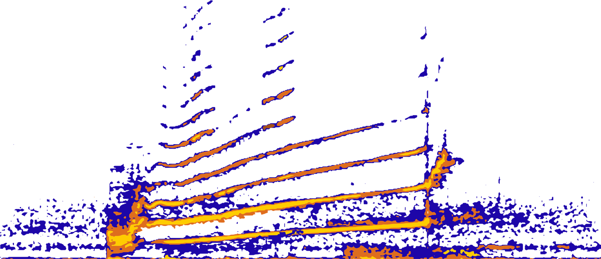

<main class="page">

<section class="hero">

Southern Resident killer whales

<!-- Add your clip as assets/orca-call.mp3 and this button appears. -->
<button id="play" class="play" type="button" hidden>&#9654; Hear this call</button>
<audio id="audio" src="assets/orca-call.mp3" preload="metadata"></audio>

74

That is the whole population. Every one fits on this page.

&#8595;

</section>

<section aria-labelledby="count-title">
<h2 id="count-title">Each block is one whale</h2>

Census of July 1, 2025. Every whale belongs to one of three pods.

<noscript>
J pod 27, K pod 14, L pod 33. The population has reached 98 at its peak, 24 more than today.
</noscript>

</section>

<section aria-labelledby="time-title">
<h2 id="time-title">Numbers over time</h2>

Live captures for marine parks in the 1960s and early 1970s took 45 whales and killed at least 13 others. Listed as endangered in the United States in 2005.

</section>

<section aria-labelledby="press-title">
<h2 id="press-title">What is pressing on them</h2>

Too little food

They depend on Chinook salmon. Declining runs leave them nutritionally stressed, which affects reproduction.

Vessel noise

Ship noise can mask the sounds they use to communicate and find food, and boat interference lowers foraging efficiency.

Contaminants

Pollutants in the marine food web are one of the main threats named by NOAA Fisheries.

So few of them

A small population has little margin, and these whales reproduce less than other killer whales in the region.

</section>

<section class="closing">
<h2>You are wearing this call</h2>

Profits from this shirt go to wildlife conservation.

<a href="https://www.orcasound.net/">Listen to the Salish Sea live with Orcasound</a>

</section>

<footer>

<strong>Sources.</strong> Population, pods, peak and captures: <a href="https://www.whaleresearch.com/orca-population">Center for Whale Research</a>. Listing and threats: <a href="https://www.fisheries.noaa.gov/west-coast/marine-mammal-protection/infographic-how-and-why-southern-resident-killer-whales-were">NOAA Fisheries</a>. Food and reproduction: <a href="https://theorcasonian.com/orca-survey-2025-census-update">The Orca Sonian</a>. Vessel noise: <a href="https://www.orcasound.net/">Orcasound</a>.

</footer>

</main>
